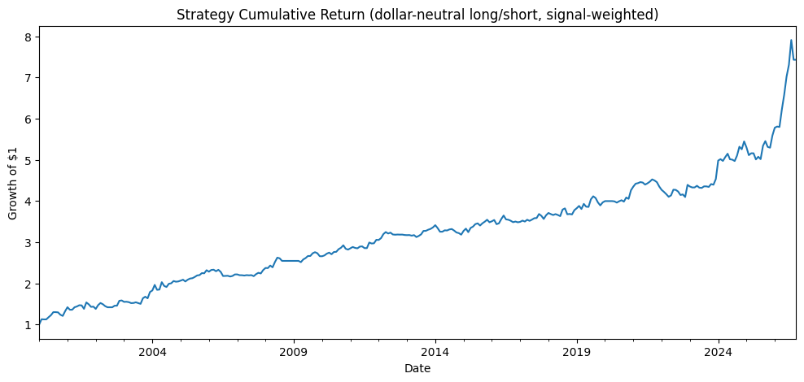
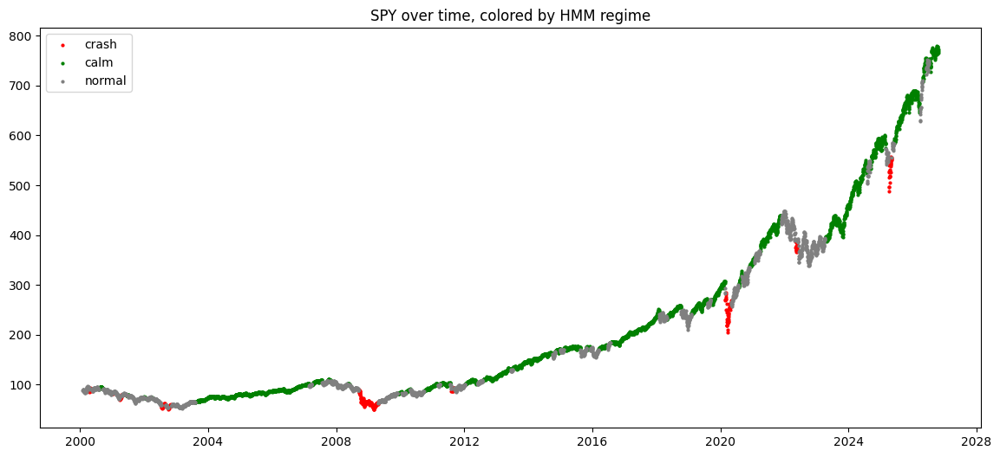
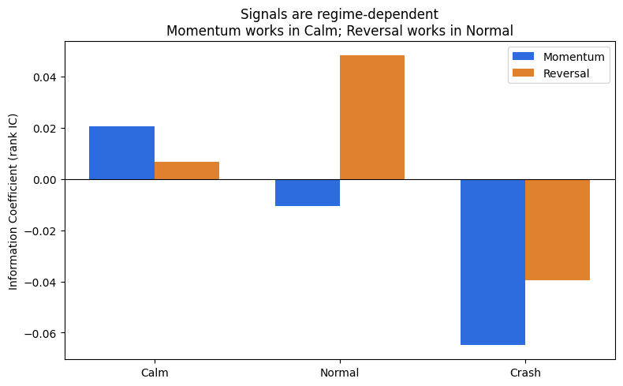
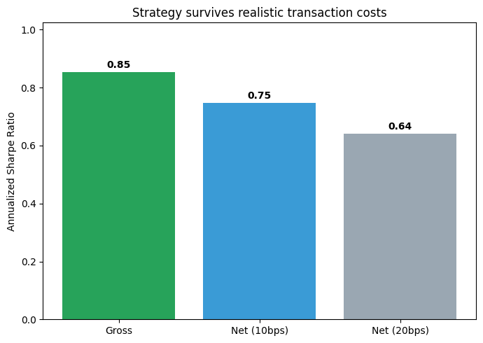

# Regime-Switching Equity Long/Short Strategy

A systematic equity strategy that detects market regimes with a Hidden Markov Model and switches between momentum and mean-reversion signals based on the detected regime. Built and tested on 503 S&P 500 stocks over 26 years (2000-present).

**Headline result:** a statistically significant, dollar-neutral long/short strategy with a net Sharpe of 0.64-0.75 (after realistic transaction costs), a 6.4x gross cumulative return, and steady growth through the 2008 crisis and the 2020 COVID crash.

> This project is deliberately documented end to end, including the dead-ends, bugs, and failed approaches, because the honest research process is the point. Most of what I tried did not work; the final strategy emerged from working through those failures.

---

## Table of Contents
- [The Question](#the-question)
- [Headline Results](#headline-results)
- [The Research Journey (including what failed)](#the-research-journey)
- [Method](#method)
- [Key Findings](#key-findings)
- [Honest Caveats](#honest-caveats)
- [Next Steps](#next-steps)
- [How to Run](#how-to-run)

---

## The Question

Can a regime-switching strategy, using different signals in different market conditions, beat running a single signal blindly? The hypothesis: momentum works in calm, trending markets; mean-reversion works in other conditions. If we can detect the market regime, we can deploy the signal that fits it.

---

## Headline Results

| Metric | Value |
|---|---|
| Signal IC | 0.031 |
| Signal t-stat | 3.1 (significant) |
| Portfolio t-stat | 4.4 |
| Gross annual Sharpe | 0.85 |
| Net Sharpe (10 bps costs) | 0.75 |
| Net Sharpe (20 bps, conservative) | 0.64 |
| Gross cumulative return (26 yrs) | 6.4x |
| Average monthly turnover | 0.82 |

The equity curve grows steadily through 2008 and 2020 because the strategy is dollar-neutral and goes flat during detected crashes.

## Results


*Cumulative return — steady growth through 2008 and COVID.*


*HMM regimes: crash (red) clusters at known crises (2002, 2008, 2020, 2022).*


*Signals are regime-dependent: momentum in calm, reversal in normal.*


*Survives realistic transaction costs (net Sharpe 0.64–0.75).*
---

## The Research Journey

The final strategy was the product of many failed attempts. This is the honest path:

1. **Single stock, momentum.** Started with one stock (MSFT), daily momentum. Weak, and it showed short-term reversal rather than momentum. Lesson: need breadth and the right horizon.
2. **Small universe, cross-sectional.** Moved to 20-32 stocks to test cross-sectionally (ranking stocks against each other), the structure of real equity research.
3. **Mean-reversion on 32 mega-caps.** Pivoted to reversal. First hit a **look-ahead bias bug** (an impossible IC of -0.78) caused by overwriting a variable so the signal overlapped the future return. Caught it (too good to be true) and fixed it. The corrected result looked promising (IC 0.019, t=3.0).
4. **Breadth test (32 to 114 stocks).** Expanded the universe, and the signal **collapsed** (t=0.86). Lesson: the small-universe result was universe-specific and did not generalize.
5. **Horizon sweep + regime split.** Swept signal/prediction horizons; found short-term reversal worked 2018-2022 but was **dead** 2023-present. Lesson: signal decay, edges get arbitraged away.
6. **Switched to monthly data.** Daily was too noisy and the wrong timescale. Monthly (with textbook 12-1 momentum) is the standard for cross-sectional equity signals, but with few stocks/years, too few observations for significance.
7. **Expanded the history.** Went from ~2010 to **2000** to add crash periods (dot-com 2000-02 and the 2008 crisis) for statistical power. (Trying to use 2008 while data started in 2010 produced an honest KeyError, the period did not exist in the data.)
8. **Full S&P 500 (503 stocks).** Pulled the full universe. Simple momentum/reversal stayed weak even at scale. Lesson: standalone famous signals are genuinely weak (arbitraged away); edge must come from combination or regime-awareness.
9. **HMM regime detection, first attempt broke.** Built an HMM but used the average of 503 stocks as the market signal. Since most stocks did not exist before 2012, the early signal was noise and the regime plot was a scattered mess. Spotted it by plotting. Also learned HMM state labels are arbitrary and reassign on every re-fit.
10. **Fixed the HMM with SPY.** Switched the regime signal to SPY (clean index data back to 2000). The regime plot became clean, the crash regime clustered exactly at 2002, 2008, 2020, and 2022. Validated.
11. **Conditional analysis.** Tested each signal within each regime. Found reversal significant in **normal** regimes (t=2.9) and momentum positive in calm regimes.
12. **The switching strategy.** Reversal in normal, momentum in calm, flat in crash → IC 0.031, t=3.1 (significant).
13. **Portfolio + costs.** Dollar-neutral, signal-weighted portfolio (Sharpe 0.85, 6.4x), then added transaction costs, it survived (net Sharpe 0.64-0.75). Tradeable.

---

## Method

**Data.** 503 S&P 500 stocks (tickers scraped from Wikipedia), daily adjusted close 2000-present via yfinance, resampled to monthly. SPY used separately as a clean market signal for regime detection.

**Signals (monthly).**
- Momentum (12-1): the 12-month return skipping the most recent month (Jegadeesh-Titman convention).
- Reversal: the negative of last month's return (recent losers expected to bounce).

**Evaluation.** Cross-sectional Information Coefficient (Spearman rank correlation between the signal and next-month returns), with a t-stat for significance (|t| > 2). Future returns are always aligned one period ahead to avoid look-ahead bias.

**Regime detection.** A 3-state Gaussian HMM (hmmlearn) fit on SPY's daily return and 21-day volatility. States are characterized by their average return and volatility into calm, normal, and crash regimes, and validated against known crises. Regime probabilities (predict_proba) are also available.

**Strategy.** Reversal in normal regimes, momentum in calm regimes, flat in crash regimes (no proven edge there, and sitting out crashes avoids losses).

**Portfolio.** Dollar-neutral (signal demeaned cross-sectionally each month so longs balance shorts, isolating alpha), signal-weighted (normalized so position size reflects signal strength). Performance measured by annualized Sharpe, cumulative return, and max drawdown.

**Transaction costs.** Turnover computed as the monthly sum of absolute weight changes; costs applied at 10 bps (realistic) and 20 bps (conservative) per unit turnover; Sharpe recomputed net of costs.

---

## Key Findings

- **Signals are regime-dependent.** Momentum works in calm markets; reversal works in normal (non-crisis, non-euphoric) markets. They are opposite bets, which is why naively averaging them cancels their edges.
- **Reversal works in normal regimes, not crashes.** Because the signal is cross-sectional (bets on stocks that fell relative to others bouncing relative to others), it needs dispersion between stocks. In crashes everything falls together (high correlation, low dispersion) and the biggest losers may be genuinely failing, so cross-sectional reversal has little to work with. Post-crash bounces also play out in the normal regime that follows.
- **Regime-switching beats blind combining.** Using each signal only where it has edge produced a significant strategy (t=3.1) where naive averaging produced roughly zero.
- **It survives transaction costs.** Net Sharpe 0.64-0.75, genuinely tradeable, not a gross-only mirage.

---

## Honest Caveats

- **Survivorship bias:** the universe is today's S&P 500 constituents applied back to 2000, which excludes companies that were dropped or failed. A point-in-time universe would be more rigorous.
- **Crash periods are not traded:** the strategy goes flat in crashes because there were too few crash months to find a reliable signal. Finding a crash-specific edge is future work.
- **Cost assumptions:** results depend on the transaction-cost estimate; reported at 10 and 20 bps.
- **Pre-slippage / pre-financing:** real-world shorting costs and market impact beyond the simple cost model are not fully modeled.

---

## Next Steps

- **Volatility-scaling:** size positions by risk (smaller bets on volatile stocks) to smooth returns and likely raise the Sharpe.
- **A crash-specific signal:** the uncrowded frontier. Improve crash-month labeling to get a usable sample, then test defensive signals (quality, low-volatility).
- **Reduce turnover** to cut costs further.
- **Point-in-time universe** to remove survivorship bias.
- **More markets / more data** for additional breadth.

---

## How to Run

```bash
pip install -r requirements.txt
```

Then open and run `regime_switching_strategy.ipynb` top to bottom. It pulls the data, builds the signals, fits the HMM, constructs the strategy and portfolio, applies transaction costs, and produces the results and plots.

**Requirements:** pandas, numpy, yfinance, hmmlearn, matplotlib, requests.

---

*Built as a self-directed quant research project. The emphasis throughout is on rigorous, honest testing, catching look-ahead bias, checking robustness across universes and regimes, validating the regime detector, and reporting results net of costs with their caveats, rather than on producing a flattering backtest.*
